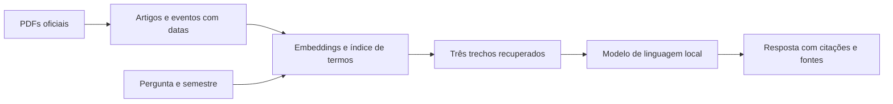

**Assistente acadêmico UFRPE com RAG**

Protótipo acadêmico independente para consultar matrícula, rematrícula, trancamento de disciplina e suspensão de programa na graduação presencial da UFRPE. A pergunta é comparada com trechos de documentos oficiais. Um modelo local elabora uma resposta em português com referências aos trechos recuperados.

O projeto inclui uma tela em Streamlit, um notebook explicativo, comandos de terminal, os dois PDFs de referência, a base extraída, 40 perguntas rotuladas e os resultados da avaliação. As consultas não exigem chave de API.



Para executar, use Python 3.11 a 3.13. A verificação inicial foi feita em Windows com Python 3.13 e GPU NVIDIA. O programa também seleciona CPU quando não encontra CUDA, com geração mais lenta. A primeira consulta baixa aproximadamente 3,6 GB de modelos públicos. Os modelos ficam em `.cache/`, fora do Git.

Na pasta do projeto, execute os comandos abaixo. O uso direto do executável do ambiente evita alterar a política de execução do PowerShell.

```powershell
python -m venv .venv
.\.venv\Scripts\python.exe -m pip install -r requirements.txt
.\.venv\Scripts\python.exe -m rag_ufrpe preparar
.\.venv\Scripts\python.exe -m streamlit run app.py
```

Abra o endereço local exibido pelo Streamlit. Digite uma pergunta e clique em **Consultar**. Para perguntas sobre datas, informe `2026.1` ou `2026.2` na pergunta ou na seleção lateral. Expanda as fontes para ler os trechos e abrir os PDFs na página correspondente.

No Linux ou macOS, substitua `.\.venv\Scripts\python.exe` por `.venv/bin/python`.

Para consultar pelo terminal, use uma destas formas.

```powershell
.\.venv\Scripts\python.exe -m rag_ufrpe perguntar "Em quanto tempo o trancamento de uma disciplina é efetivado?"
.\.venv\Scripts\python.exe -m rag_ufrpe perguntar "Qual o prazo de matrícula em 2026.2?"
.\.venv\Scripts\python.exe -m rag_ufrpe perguntar "Qual o prazo de trancamento?" --semestre 2026.1 --backend sources
```

O modo `sources` mostra somente os trechos, sem carregar o gerador. Para seguir o experimento por etapas, abra `notebooks/projeto_rag.ipynb` no VS Code ou em outro editor Jupyter, selecionando o Python do ambiente criado. As células usam os mesmos módulos da aplicação.

Os documentos da base foram conferidos em 23/11/2026. O manifesto `dados/fontes.csv` registra os links oficiais, o recorte de artigos e o SHA-256 de cada PDF. O regulamento é a Resolução 744/2024. O calendário é a Resolução 1004/2026, cuja página oficial registra a substituição da Resolução 960/2025. A atualização futura exige nova conferência dos documentos. [Regulamento na SEG/UFRPE](https://seg.ufrpe.br/content/ufrpe-tem-novas-regras-para-solicitacao-de-colacao-de-grau-antecipada), [calendário na SEG/UFRPE](https://seg.ufrpe.br/content/res-no-10042026).

A extração usa os artigos 229 a 264 do regulamento, com parágrafos que podem continuar na página seguinte. Artigos longos são divididos em até 180 palavras, com sobreposição de 35 palavras. O calendário é separado por evento, mantendo o mês, a data, o semestre e a página. Linhas sem descrição inicial completa são excluídas deste recorte. O resultado está em `dados/trechos.json`. Os PDFs originais são preservados para conferência.

A busca usa `intfloat/multilingual-e5-small`, com os prefixos `query:` e `passage:`, embeddings normalizados e similaridade de cosseno. O ranking combina 65% de similaridade semântica centralizada com 35% de TF-IDF. Esses pesos são escolhas iniciais do protótipo. Perguntas sobre datas consultam eventos do semestre e do tipo de procedimento informado. Sem outro detalhe, matrícula e rematrícula retornam a solicitação do(a) aluno(a) regular, e não o processamento. Perguntas sobre regras consultam os artigos. Uma pergunta com “prazo” é tratada como regra quando também indica “máximo”, “efetivado”, “limite” ou “depois do prazo”. O semestre pode ser escrito como 2026.1, 2026/1, 2026-1 ou “1º semestre de 2026”. O escopo é decidido por palavras-chave do domínio. O índice tem uma impressão digital do conteúdo para evitar reutilizar embeddings de uma versão diferente da base. [Modelo E5](https://huggingface.co/intfloat/multilingual-e5-small).

A geração padrão utiliza `Qwen/Qwen2.5-1.5B-Instruct` localmente, apenas para perguntas sobre regras. O gerador recebe somente o trecho mais bem classificado, dois exemplos (uma resposta e uma abstenção) e a instrução de responder “A fonte não traz informação sobre isso.” quando a fonte não trata do assunto. Ele devolve um JSON com resposta e números das fontes. O programa valida a estrutura e confere a compatibilidade dos números, inclusive os escritos por extenso, e das durações em perguntas sobre tempo. Em vez da resposta, a aplicação mostra o trecho original quando a resposta começa com “sim” diante de uma proibição, quando começa com “não” sem nenhuma negação na fonte, ou quando mais de 45% das palavras de conteúdo não aparecem na fonte nem na pergunta. Esses limites são heurísticas conservadoras, calibradas em cerca de 15 exemplos. Perguntas sobre eventos do calendário não usam o modelo: a resposta é montada a partir do evento, com a data registrada. Os demais trechos recuperados ficam disponíveis para conferência. Usar um só trecho reduz a mistura entre regras de procedimentos diferentes, mas limita respostas que exigem combinar vários artigos. As checagens cobrem erros específicos. A correspondência entre cada afirmação e a fonte precisa de revisão humana. [Modelo Qwen](https://huggingface.co/Qwen/Qwen2.5-1.5B-Instruct).

Se já utiliza Ollama, copie `.env.example` para `.env`, ajuste `GENERATION_BACKEND=ollama` e informe um modelo disponível no seu servidor em `OLLAMA_MODEL`. O comando de terminal equivalente usa `--backend ollama`. A integração foi implementada, mas a verificação da geração nesta entrega usa o backend local. [API do Ollama](https://docs.ollama.com/api/chat).

Para avaliar a busca e executar os testes de regressão, use os comandos abaixo.

```powershell
.\.venv\Scripts\python.exe -m rag_ufrpe avaliar --split dev
.\.venv\Scripts\python.exe -m rag_ufrpe avaliar --split test
.\.venv\Scripts\python.exe -m rag_ufrpe avaliar --split parafrase
.\.venv\Scripts\python.exe -m rag_ufrpe exemplos --split all
.\.venv\Scripts\python.exe -m unittest discover -s tests -v
```

O arquivo `avaliacao/perguntas.csv` tem três grupos. Os grupos `dev` e `test` têm 10 casos cada, com seis perguntas respondíveis e quatro casos de abstenção ou esclarecimento, e foram inspecionados durante o desenvolvimento. O grupo `parafrase` tem 20 casos: 17 respondíveis, com reformulações e outros formatos de semestre, e 3 sem evidência no recorte. Ele foi escrito em 25/11/2026, depois de sondar falhas da busca, e as correções dessa data foram feitas olhando para ele. É um conjunto de diagnóstico, e as suas métricas são otimistas, não uma avaliação independente. Os rótulos e respostas esperadas foram elaborados para este protótipo com base nos documentos. Ainda precisam de revisão por alguém que conheça as normas.

Os comandos geram métricas e resultados por pergunta em `avaliacao/`. Precisão@3 divide o número de trechos relevantes recuperados por três, contando posições ausentes como zero. Revocação@3 mede a proporção dos trechos esperados que foram encontrados. F1@3 combina as duas medidas. Hit@3 registra se apareceu ao menos um trecho esperado. Hit@1 avalia a primeira posição, usada na geração. Perguntas que exigem abstenção são avaliadas separadamente. Esses resultados avaliam a busca e os filtros. Exemplos de geração ficam registrados separadamente para revisão. Com um único trecho relevante por pergunta, a Precisão@3 não passa de 0,3333, e as perguntas de calendário retornam um só trecho. Por isso a avaliação também informa a precisão sobre os trechos retornados e o MRR@3, o inverso da posição do primeiro trecho relevante. O comando `exemplos` grava em `avaliacao/geracao_exemplos.json` as respostas completas, inclusive as dos casos sem evidência, para revisão humana.

Na execução de 25/11/2026, os resultados da recuperação foram os seguintes. Os grupos `dev` e `test` não mudaram de resultado em relação a 23/11. Para o grupo de paráfrases, a coluna “antes” usa o código de 23/11 e a coluna “depois” usa o código atual. Como as correções foram guiadas por esse grupo, a melhora é otimista. Há um único trecho diretamente relevante por pergunta, exceto em `p11`, que tem dois.

| Métrica | Desenvolvimento | Teste piloto | Paráfrases antes | Paráfrases depois |
| --- | --- | --- | --- | --- |
| Casos respondíveis / sem resposta | 6 / 4 | 6 / 4 | 17 / 3 | 17 / 3 |
| Precisão@3 | 0,3333 | 0,3333 | – | 0,3333 |
| Precisão sobre os trechos retornados | 0,6667 | 0,6667 | – | 0,4510 |
| Revocação@3 | 1,0000 | 1,0000 | – | 0,9412 |
| Hit@1 | 1,0000 | 1,0000 | 0,4118 | 0,7647 |
| Hit@3 | 1,0000 | 1,0000 | 0,5882 | 0,9412 |
| MRR@3 | 1,0000 | 1,0000 | 0,4902 | 0,8431 |
| Acerto do status nas respondíveis | 1,0000 | 1,0000 | 0,5882 | 0,9412 |
| Acerto do status de abstenção | 1,0000 | 1,0000 | 0,0000 | 0,0000 |

O acerto do status de abstenção nas paráfrases é zero porque a busca não detecta ausência de evidência. Nesses três casos quem se abstém é o gerador (ver as limitações).

Os 58 testes automatizados passam sem baixar modelos: a busca é testada com um codificador falso e o gerador com respostas simuladas. Cobrem a extração, a integridade dos PDFs contra o manifesto, os filtros de pergunta, a busca, as métricas e as checagens da geração. Em 25/11/2026, a tela foi exercitada com o AppTest do Streamlit em cinco cenários (fora do escopo, data sem semestre, calendário com semestre na lateral, regra com gerador e somente trechos), sem exceções. O notebook foi executado por completo e os 32 exemplos generativos foram regenerados com o modelo local. Os exemplos permanecem marcados para revisão independente, inclusive quando o programa opta por mostrar a regra original.

**Limitações conhecidas.** O conjunto é pequeno e cobre somente o recorte definido. Perguntas sobre situações individuais, novas resoluções ou semestres futuros podem exigir outros documentos. Os documentos e a base ficam estáticos até uma atualização explícita. A aplicação não registra as perguntas em arquivos nem solicita dados pessoais.

- **A busca não detecta ausência de evidência.** Os scores de perguntas fora da base (0,28 a 0,50) se sobrepõem aos das respondíveis (0,44 a 0,60), então o corte mínimo de 0,10 só descarta resultados degenerados. No modo `sources`, uma pergunta como “Como funciona a biblioteca?” mostra três artigos irrelevantes. Com o gerador, as 5 perguntas sem evidência testadas resultaram em abstenção. Antes do prompt atual, 2 delas receberam respostas sem apoio na fonte, mas com a citação [1], como “não precisa pagar para trancar”. Essa proteção depende do modelo e não é uma garantia.
- **O escopo é decidido por palavras-chave.** “Qual o limite de horas por semana para quem estuda à noite?” é recusada por não conter nenhuma palavra da lista. Em sentido inverso, uma pergunta alheia ao tema que contenha uma dessas palavras passa pelo filtro.
- **O ranking falha em algumas paráfrases.** Nas paráfrases, o Hit@1 é 0,76. Em `p01`, `p03` e `p04` o trecho certo aparece em segundo ou terceiro lugar. Testamos TF-IDF por n-gramas de caracteres, que acertou 1 pergunta a mais sem piorar `dev` e `test`. A diferença está dentro do ruído de 17 perguntas, e a mudança não foi adotada.
- **O gerador usa um único trecho e pode omitir exceções ou responder fora do tópico.** Em `d03` e `p05` a resposta omite as exceções da regra. Em `p01`, o trecho recuperado era outro artigo e a resposta não tratava da pergunta. As checagens não verificam a relevância da resposta nem detectam omissões. O modelo de 1,5 bilhão de parâmetros também chegou a inverter um sim/não (`t01`) depois da inclusão do exemplo de abstenção no prompt. Hoje esse caso cai na regra original por uma checagem específica.
- **As checagens da geração são heurísticas.** Elas procuram números incompatíveis, polaridade sem apoio na fonte e vocabulário ausente da fonte, e mostram a regra original quando disparam. Não detectam afirmações falsas escritas com palavras da fonte.

Os arquivos têm as seguintes funções.

| Arquivo ou pasta | Função |
| --- | --- |
| `app.py` | Tela de consulta |
| `rag_ufrpe/corpus.py` | Verificação de PDFs e extração |
| `rag_ufrpe/retrieval.py` | Busca e filtros de semestre |
| `rag_ufrpe/generation.py` | Geração e checagem das citações |
| `rag_ufrpe/evaluation.py` | Avaliação da recuperação e geração dos exemplos |
| `dados/` | Manifesto, PDFs e trechos |
| `avaliacao/` | Perguntas, métricas e resultados |
| `notebooks/` | Experimento explicado e executado |
| `tests/` | Testes de extração, filtros, busca, avaliação e falhas |

O `.gitignore` exclui credenciais, ambientes e modelos baixados. O repositório contém o código e os documentos de referência. Para executar a tela, siga os comandos de instalação acima. Os documentos institucionais mantêm sua autoria e origem indicadas no manifesto.
