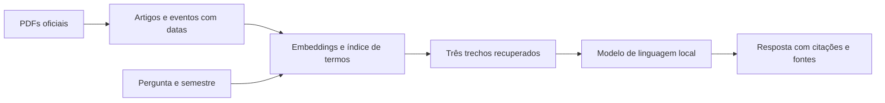

**Assistente acadêmico UFRPE com RAG**

Protótipo acadêmico independente para consultar matrícula, rematrícula, trancamento de disciplina e suspensão de programa na graduação presencial da UFRPE. A pergunta é comparada com trechos de documentos oficiais. Um modelo local elabora uma resposta em português com referências aos trechos recuperados.

O projeto inclui uma tela em Streamlit, um notebook explicativo, comandos de terminal, os dois PDFs de referência, a base extraída, 20 perguntas rotuladas e os resultados da avaliação. As consultas não exigem chave de API.



Para executar, use Python 3.11 a 3.13. A verificação inicial foi feita em Windows com Python 3.13 e GPU NVIDIA. O programa também seleciona CPU quando não encontra CUDA, com geração mais lenta. A primeira consulta baixa aproximadamente 3,6 GB de modelos públicos. Os modelos ficam em `.cache/`, fora do Git.

Na pasta do projeto, execute os comandos abaixo. O uso direto do executável do ambiente evita alterar a política de execução do PowerShell.

```powershell
python -m venv .venv
.\.venv\Scripts\python.exe -m pip install -r requirements.txt
.\.venv\Scripts\python.exe -m rag_ufrpe preparar
.\.venv\Scripts\python.exe -m streamlit run app.py
```

Abra o endereço local exibido pelo Streamlit. Digite uma pergunta e clique em **Consultar**. Para perguntas sobre datas, informe `2026.1` ou `2026.2` na pergunta ou na seleção lateral. Expanda as fontes para ler os trechos e abrir os PDFs na página correspondente.

No Linux ou macOS, substitua `.\.venv\Scripts\python.exe` por `.venv/bin/python`.

Para consultar pelo terminal, use uma destas formas.

```powershell
.\.venv\Scripts\python.exe -m rag_ufrpe perguntar "Em quanto tempo o trancamento de uma disciplina é efetivado?"
.\.venv\Scripts\python.exe -m rag_ufrpe perguntar "Qual o prazo de matrícula em 2026.2?"
.\.venv\Scripts\python.exe -m rag_ufrpe perguntar "Qual o prazo de trancamento?" --semestre 2026.1 --backend sources
```

O modo `sources` mostra somente os trechos, sem carregar o gerador. Para seguir o experimento por etapas, abra `notebooks/projeto_rag.ipynb` no VS Code ou em outro editor Jupyter, selecionando o Python do ambiente criado. As células usam os mesmos módulos da aplicação.

Os documentos da base foram conferidos em 23/11/2026. O manifesto `dados/fontes.csv` registra os links oficiais, o recorte de artigos e o SHA-256 de cada PDF. O regulamento é a Resolução 744/2024. O calendário é a Resolução 1004/2026, cuja página oficial registra a substituição da Resolução 960/2025. A atualização futura exige nova conferência dos documentos. [Regulamento na SEG/UFRPE](https://seg.ufrpe.br/content/ufrpe-tem-novas-regras-para-solicitacao-de-colacao-de-grau-antecipada), [calendário na SEG/UFRPE](https://seg.ufrpe.br/content/res-no-10042026).

A extração usa os artigos 229 a 264 do regulamento, com parágrafos que podem continuar na página seguinte. Artigos longos são divididos em até 180 palavras, com sobreposição de 35 palavras. O calendário é separado por evento, mantendo o mês, a data, o semestre e a página. Linhas sem descrição inicial completa são excluídas deste recorte. O resultado está em `dados/trechos.json`. Os PDFs originais são preservados para conferência.

A busca usa `intfloat/multilingual-e5-small`, com os prefixos `query:` e `passage:`, embeddings normalizados e similaridade de cosseno. O ranking combina 65% de similaridade semântica centralizada com 35% de TF-IDF. Esses pesos são escolhas iniciais do protótipo. Perguntas sobre datas consultam eventos do semestre e do tipo de procedimento informado. Perguntas sobre regras consultam os artigos. O índice tem uma impressão digital do conteúdo para evitar reutilizar embeddings de uma versão diferente da base. [Modelo E5](https://huggingface.co/intfloat/multilingual-e5-small).

A geração padrão utiliza `Qwen/Qwen2.5-1.5B-Instruct` localmente. O gerador recebe somente o trecho mais bem classificado e devolve um JSON com resposta e números das fontes. O programa valida a estrutura, confere a compatibilidade dos números e monta a citação exibida na tela. Perguntas sobre tempo também exigem uma duração compatível com a fonte. Em caso de incompatibilidade, a aplicação mostra o trecho original. Para eventos do calendário, a data extraída é exibida junto da resposta. Os demais trechos recuperados ficam disponíveis para conferência. Esse recorte reduz a mistura entre regras de procedimentos diferentes, mas limita respostas que exigem combinar vários artigos. As checagens numéricas cobrem alguns erros específicos. A correspondência entre cada afirmação e a fonte precisa de revisão humana. [Modelo Qwen](https://huggingface.co/Qwen/Qwen2.5-1.5B-Instruct).

Se já utiliza Ollama, copie `.env.example` para `.env`, ajuste `GENERATION_BACKEND=ollama` e informe um modelo disponível no seu servidor em `OLLAMA_MODEL`. O comando de terminal equivalente usa `--backend ollama`. A integração foi implementada, mas a verificação da geração nesta entrega usa o backend local. [API do Ollama](https://docs.ollama.com/api/chat).

Para avaliar a busca e executar os testes de regressão, use os comandos abaixo.

```powershell
.\.venv\Scripts\python.exe -m rag_ufrpe avaliar --split dev
.\.venv\Scripts\python.exe -m rag_ufrpe avaliar --split test
.\.venv\Scripts\python.exe -m unittest discover -s tests -v
```

O arquivo `avaliacao/perguntas.csv` contém 10 casos de desenvolvimento e 10 de teste piloto. Cada grupo tem seis perguntas respondíveis e quatro casos de abstenção ou esclarecimento. Os dois grupos foram inspecionados durante o desenvolvimento, portanto os números são uma avaliação exploratória. Uma avaliação independente exige novas perguntas reservadas. Os rótulos e respostas esperadas foram elaborados para este protótipo com base nos documentos. Ainda precisam de revisão por alguém que conheça as normas.

Os comandos geram métricas e resultados por pergunta em `avaliacao/`. Precisão@3 divide o número de trechos relevantes recuperados por três, contando posições ausentes como zero. Revocação@3 mede a proporção dos trechos esperados que foram encontrados. F1@3 combina as duas medidas. Hit@3 registra se apareceu ao menos um trecho esperado. Hit@1 avalia a primeira posição, usada na geração. Perguntas que exigem abstenção são avaliadas separadamente. Esses resultados avaliam a busca e os filtros. Exemplos de geração ficam registrados separadamente para revisão.

Na execução de 23/11/2026, os resultados da recuperação foram os seguintes. Cada grupo tem seis perguntas respondíveis e quatro casos de abstenção. Há um único trecho diretamente relevante rotulado por pergunta.

| Métrica | Desenvolvimento | Teste piloto |
| --- | --- | --- |
| Precisão@3 | 0,3333 | 0,3333 |
| Revocação@3 | 1,0000 | 1,0000 |
| F1@3 | 0,5000 | 0,5000 |
| Hit@1 | 1,0000 | 1,0000 |
| Hit@3 | 1,0000 | 1,0000 |
| Acerto do status de abstenção | 1,0000 | 1,0000 |

Os 19 testes automatizados passaram na verificação inicial. A tela foi exercitada com pergunta fora do tema, consulta de fontes e geração local. O notebook foi executado por completo. Os exemplos generativos permanecem marcados para revisão independente, inclusive quando o programa opta por mostrar a regra original.

O conjunto de teste é pequeno e cobre somente o recorte definido. Perguntas sobre situações individuais, novas resoluções ou semestres futuros podem exigir outros documentos. O filtro de escopo usa regras simples, e o modelo pode interpretar incorretamente um trecho mesmo quando cita uma fonte válida. Durante o desenvolvimento, o gerador confundiu uma duração e omitiu exceções de uma regra. As checagens passaram a mostrar o trecho original quando detectam duração incompatível ou uma resposta iniciada por “sim” diante de uma proibição explícita. Essas regras são conservadoras e não detectam todas as contradições. Os documentos e a base ficam estáticos até uma atualização explícita. A aplicação não registra as perguntas em arquivos nem solicita dados pessoais.

Os arquivos têm as seguintes funções.

| Arquivo ou pasta | Função |
| --- | --- |
| `app.py` | Tela de consulta |
| `rag_ufrpe/corpus.py` | Verificação de PDFs e extração |
| `rag_ufrpe/retrieval.py` | Busca e filtros de semestre |
| `rag_ufrpe/generation.py` | Geração e checagem das citações |
| `rag_ufrpe/evaluation.py` | Avaliação da recuperação |
| `dados/` | Manifesto, PDFs e trechos |
| `avaliacao/` | Perguntas, métricas e resultados |
| `notebooks/` | Experimento explicado e executado |
| `tests/` | Testes de extração, filtros e falhas |

O `.gitignore` exclui credenciais, ambientes e modelos baixados. O repositório contém o código e os documentos de referência. Para executar a tela, siga os comandos de instalação acima. Os documentos institucionais mantêm sua autoria e origem indicadas no manifesto.
